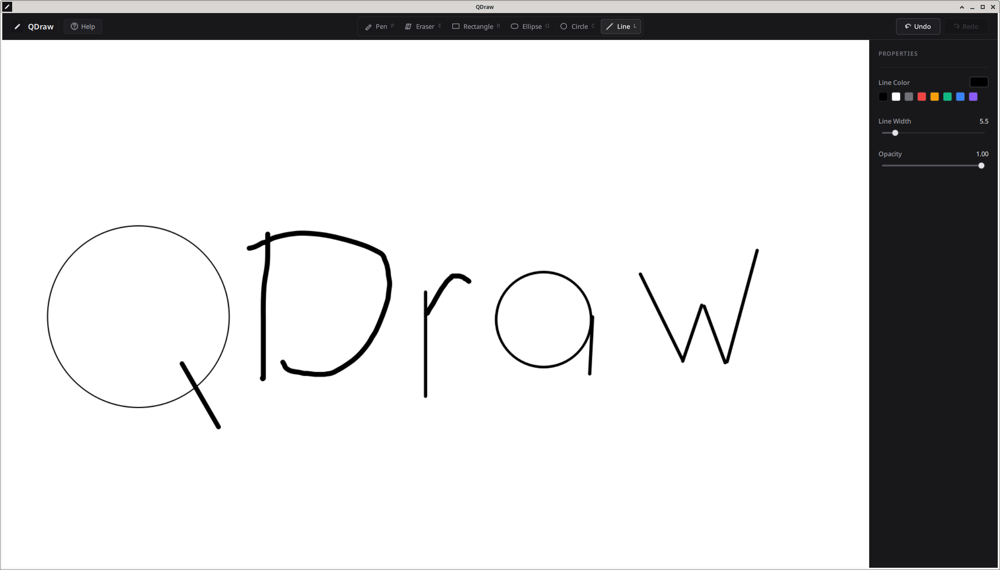
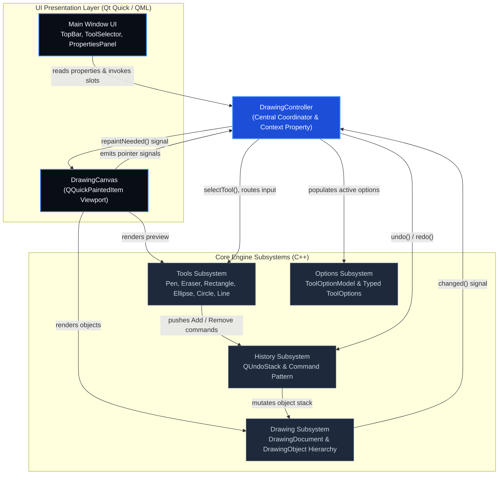

# QDraw

A simple vector sketching and drawing desktop application built with Qt 6 (Quick / QML) and C++20.



## Architecture Overview



## Prerequisites (local build)

- CMake 3.16+
- Qt 6.5+ (`Quick` module)
- A C++17 compiler (GCC or Clang)

```bash
cmake -S . -B build -G Ninja -DCMAKE_BUILD_TYPE=Debug -DBUILD_TESTS=ON
cmake --build build
./build/appQDraw
```

## Running Tests

Unit tests validate core data structures, geometry & math routines, hit-testing algorithms, and command history. They run headless and do not require GUI or display servers.

### 1. Run Tests Locally

Build and run all test suites with CTest:

```bash
cmake -B build -DBUILD_TESTS=ON
cmake --build build
ctest --test-dir build --output-on-failure
```

You can also run individual test suite binaries directly:

```bash
./build/tests/tst_math         # Math, geometry & spline tests
./build/tests/tst_hittesting   # Shape hit-testing against circles
./build/tests/tst_document     # Document container & signal tests
./build/tests/tst_history      # Undo/redo stack and command tests
```

### 2. Run Tests Using Docker

Since test suites run headlessly, they can be built and executed in Docker without display forwarding.

**With Docker Compose:**

```bash
docker compose run --rm test
```

**With plain Docker:**

```bash
docker build --target builder -t qdraw:test .
docker run --rm qdraw:test ctest --test-dir build --output-on-failure
```

To run a specific test suite binary inside Docker:

```bash
docker run --rm qdraw:test ./build/tests/tst_math
```

## Running the Application with Docker

The image is built in two stages: compile the app on Ubuntu 24.04, then run it in a slim runtime image with Qt 6 libraries. Because this is a **GUI** app, the container must connect to your host display (X11).

### 1. Install Docker

Install [Docker Engine](https://docs.docker.com/engine/install/) and ensure your user can run `docker` (or use `sudo`).

Optional: install [Docker Compose](https://docs.docker.com/compose/install/) (Compose V2 is included with recent Docker packages as `docker compose`).

### 2. Build the image

From the project root:

```bash
docker build -t qdraw:latest .
```

Or with Compose:

```bash
docker compose build
```

The first build downloads packages and Qt dependencies; later builds are faster thanks to layer caching.

### 3. Allow the container to use your display (Linux)

On the **host**, allow local Docker clients to connect to the X server (run once per session, or add to your login scripts):

```bash
xhost +local:docker
```

On **Arch Linux**, install `xhost` first if it is missing: `sudo pacman -S xorg-xhost`. On Wayland with XWayland, ensure `DISPLAY` is set (often `:0`).

Ensure `DISPLAY` is set (usually `:0` or `:1`):

```bash
echo "$DISPLAY"
```

### 4. Run the application

**With Docker Compose (recommended):**

```bash
docker compose run --rm qdraw
```

**With plain Docker:**

```bash
docker run --rm \
  -e DISPLAY="$DISPLAY" \
  -v /tmp/.X11-unix:/tmp/.X11-unix:rw \
  --device /dev/dri \
  qdraw:latest
```

### 5. Stop / cleanup

- Compose run exits when you close the app (`--rm` removes the container).
- Revoke X access when finished (optional):

```bash
xhost -local:docker
```

- Remove the image:

```bash
docker rmi qdraw:latest
```

## Troubleshooting

| Issue | What to try |
|--------|-------------|
| `cannot open display` | Check `echo $DISPLAY`, run `xhost +local:docker`, confirm `/tmp/.X11-unix` is mounted. |
| `libEGL.so.1: cannot open shared object` | Rebuild the image (`docker compose build --no-cache`) so the runtime stage picks up EGL libraries. |
| Blank window / GL errors | Keep `--device /dev/dri` (see `docker-compose.yml`). On some setups you may need proprietary GPU drivers on the host. |
| Wayland-only session | Prefer an XWayland session, or set `QT_QPA_PLATFORM=wayland` and pass a Wayland socket (advanced; X11 setup above is the default). |
| Slow first `docker build` | Qt 6.5 is downloaded via `aqtinstall` during the image build; later builds reuse cached layers. |

## Project layout

| File / Directory | Purpose |
|------------------|---------|
| `CMakeLists.txt` | Build configuration and test registration |
| `include/qdraw/math/` | Math & geometry constants and declarations |
| `src/math/` | Math calculation & geometric algorithm implementations |
| `src/drawing/` | Drawing document and shape objects |
| `src/tools/` | Interactive creation and editing tools |
| `tests/` | Automated unit test suites (CTest) |
| `main.cpp` | Application entry point |
| `Main.qml` | Main UI |
| `Dockerfile` | Multi-stage build (tests) and runtime image |
| `docker-compose.yml` | Run app with GUI display mapping or run tests |
