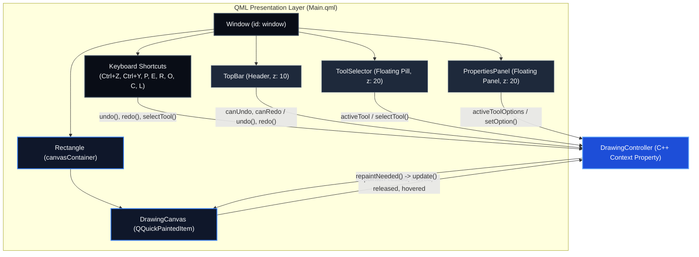

# QML Presentation Layer

## What
The QML Presentation Layer defines the declarative graphical interface, window hierarchy, responsive layout, and user input bindings for QDraw.

## Why
- **Strict presentation-only boundary:** QML is designed for declarative UI composition, layouts, styling, and animations. Allowing QML to directly construct geometry, maintain undo lists, or handle object memory leaks business logic into the view layer. In QDraw, QML communicates with C++ solely through `DrawingController` via `Q_PROPERTY` reads and `Q_INVOKABLE` method invocations.
- **What QML must NEVER do:**
  - Never instantiate or delete `DrawingObject` instances.
  - Never execute geometry calculations or hit-testing algorithms.
  - Never store drawing history stacks or manipulate undo/redo commands.
  - Never hardcode tool-specific property fields in panels.

## How
- `Main.qml` configures the application window, top bar, canvas container, and floating panels.
- Global keyboard shortcuts (`Ctrl+Z`, `Ctrl+Y`, tool selection keys `P`, `E`, `R`, `O`, `C`, `L`) route directly to `controller.undo()`, `controller.redo()`, and `controller.selectTool()`.
- The canvas item `DrawingCanvas` is embedded as a `QQuickPaintedItem` in the central workspace.

## Presentation Architecture

## Files

| File | Role |
|---|---|
| `Main.qml` | Top-level window hosting layout structure, canvas view, toolbars, and global shortcuts. |
| `components/` | Subdirectory containing modular UI components (top bar, tool selector, properties panel, delegates). |
| `icons/` | Subdirectory containing standalone vector and canvas-based icon components (`PenIcon`, `EraserIcon`, `LineIcon`, `UndoIcon`, `RedoIcon`, etc.). |

## Boundaries
- QML does **NOT** perform raster painting or Catmull-Rom spline calculations; all rendering is performed by `QPainter` in C++.
- QML does **NOT** own application models or tool registries.
