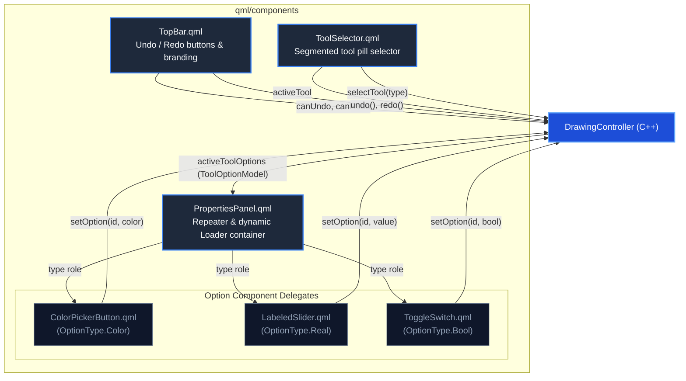

# QML Components Subsystem

## What
The QML Components Subsystem provides reusable presentation elements for toolbars, property editors, and application navigation.

## Why
- **Declarative, data-driven properties panel:** Traditional desktop forms hardcode input controls per tool. `PropertiesPanel` uses a `Repeater` bound to `controller.activeToolOptions` and loads controls dynamically via QML `Loader`. Adding a new property or tool requires zero UI layout changes.
- **Custom lightweight UI over heavy stock widgets:** Stock Qt Quick Controls often look generic or misaligned with dark themes. These customized components (`LabeledSlider`, `ColorPickerButton`, `ToggleSwitch`) use curated slate/zinc color tokens, crisp typography, and micro-animations for a modern desktop feel.

## How
- `PropertiesPanel` inspects each item's `type` role (`OptionType.Color`, `OptionType.Real`, `OptionType.Bool`) and instantiates the matching component delegate.
- Input changes in delegates immediately invoke `controller.setOption(id, value)`.
- `ToolSelector` invokes `controller.selectTool(toolType)` as the single tool activation entry point.
- `TopBar` observes `controller.canUndo` and `controller.canRedo` to adjust visual opacity and click interactivity.

### How to Add a New Option Type Control
1. Add the enum value to `OptionType` in `ToolOption.h`.
2. Create a component delegate (e.g. `StringInput.qml`) in `qml/components/`.
3. Add a branch to `PropertiesPanel.qml`'s `Loader.sourceComponent` switch statement.

## Component Architecture

## Files

| File | Role |
|---|---|
| `TopBar.qml` | Application header with branding and undo/redo buttons. |
| `ToolSelector.qml` | Segmented tool pill with tool icons, labels, and active indicator. |
| `PropertiesPanel.qml` | Data-driven container dynamically hosting delegates for active tool options. |
| `LabeledSlider.qml` | Continuous bounded slider with numeric readout and custom track. |
| `ColorPickerButton.qml` | Color swatch button with preset palette pills and native color dialog. |
| `ToggleSwitch.qml` | Animated toggle switch for boolean tool options. |

## Boundaries
- Components do **NOT** store business state or geometry; all mutations are forwarded to `controller`.
- Components do **NOT** manage drawing history or canvas coordinates.
