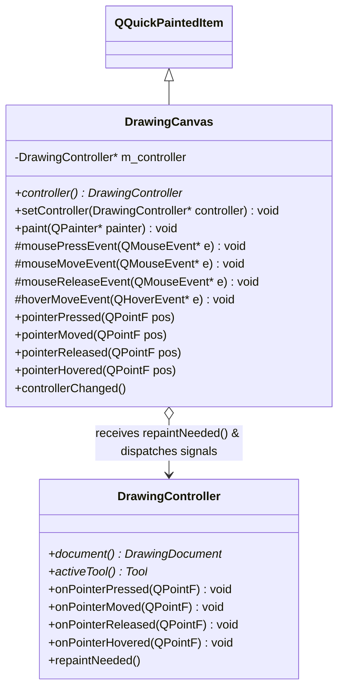
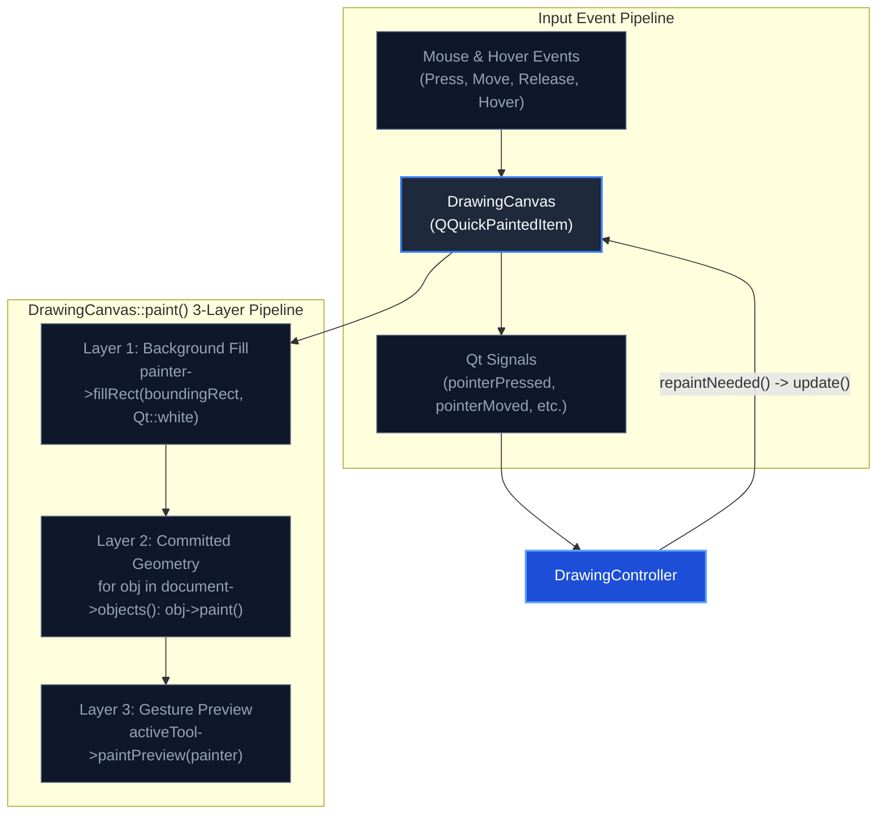

# Canvas Subsystem

## What
The Canvas Subsystem integrates the C++ rendering engine with Qt Quick via `QQuickPaintedItem`, handling viewport repainting and converting raw pointer and hover events into clean signals.

## Why
- **Signals over direct controller coupling:** If `DrawingCanvas` held concrete dependencies on tools or history logic, testing the rendering item in isolation would require mocking the entire application state. By emitting standard Qt signals (`pointerPressed`, `pointerMoved`, `pointerReleased`, `pointerHovered`), the canvas remains a pure input/render view. The controller subscribes to these signals, achieving clean inversion of control and loose coupling.
- **Hover events for the eraser cursor:** Standard mouse move events only fire while a mouse button is actively held down. To render an intuitive circular cursor indicator preview before the user clicks to erase, hover events (`setAcceptHoverEvents(true)`) are required. This allows `EraserTool` to track pointer coordinates smoothly during passive movement without triggering accidental object deletions.

## How
- `DrawingCanvas` subclasses `QQuickPaintedItem` and overrides `paint(QPainter*)`.
- The paint sequence executes in three distinct layers:
  1. Solid canvas background fill (`Qt::white`).
  2. Committed objects iterated from `DrawingDocument::objects()` via `DrawingController::document()`.
  3. Interactive gesture preview rendered via `activeTool()->paintPreview()`.
- When the document changes or tool previews update, `DrawingController` emits `repaintNeeded()`, causing the canvas to schedule an asynchronous paint pass via `update()`.

## Architecture Diagram

### Rendering & Event Flow

## Files

| File | Role |
|---|---|
| `DrawingCanvas.h` / `.cpp` | `QQuickPaintedItem` providing viewport rendering, hover tracking, and input event signals. |

## Boundaries
- This subsystem does **NOT** interpret what gestures mean; clicking or dragging is forwarded blindly as coordinates.
- This subsystem does **NOT** own drawing objects, undo stacks, or tool state.
