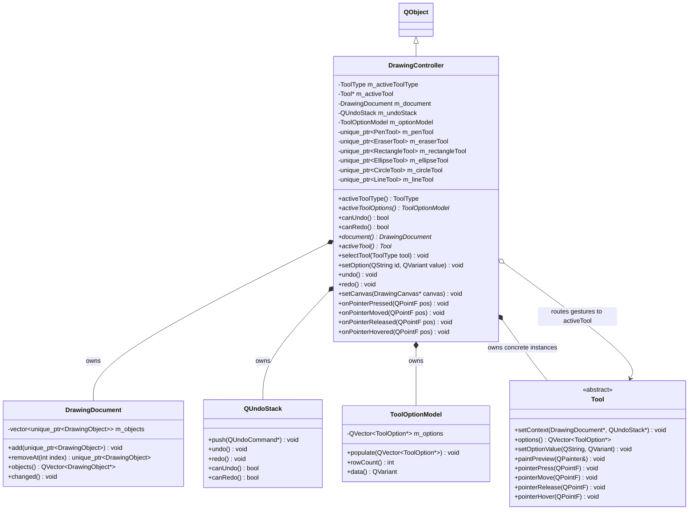

# Controller Subsystem

## What
The Controller Subsystem orchestrates the application backend, providing the single unified interface between Qt Quick (QML) and C++ business logic.

## Why
- **Single activation entry point (`selectTool`):** Routing tool changes through a single method guarantees that tool deactivation, lifecycle cleanup, signal disconnection, model repopulation, and repaint requests happen atomically. If QML or shortcuts could instantiate or swap tools arbitrarily, state synchronization between the canvas, properties panel, and tools would become fragmented.
- **Centralized signal routing and wiring:** `DrawingController` acts as a coordinator. It connects canvas input signals to active tool methods, document change signals to canvas repaints, and tool option modifications to QML models. Neither the canvas nor the tools need direct knowledge of one another.

## How
- `DrawingController` owns all concrete tools as persistent `std::unique_ptr` instances (preserving their configured options across switches), along with the `DrawingDocument`, `QUndoStack`, and `ToolOptionModel`.
- Exposed properties (`activeTool`, `activeToolOptions`, `canUndo`, `canRedo`) allow QML views to update reactively.
- When `selectTool(tool)` is invoked:
  1. The outgoing tool is deactivated and its `previewChanged()` signal disconnected.
  2. The active tool pointer shifts to the chosen tool.
  3. `ToolOptionModel::populate()` repopulates available options for that tool.
  4. The incoming tool is activated and wired to trigger canvas repaints on preview updates.
  5. `activeToolChanged()` and `repaintNeeded()` are emitted.

## Class Architecture

## Files

| File | Role |
|---|---|
| `DrawingController.h` / `.cpp` | Central coordinator exposing QML-invokable methods, owning backend state, and routing canvas signals. |

## Boundaries
- The controller does **NOT** perform low-level raster painting; that belongs in `DrawingCanvas` and `DrawingObject`.
- The controller does **NOT** render UI controls or manage window layouts; that belongs in QML.
