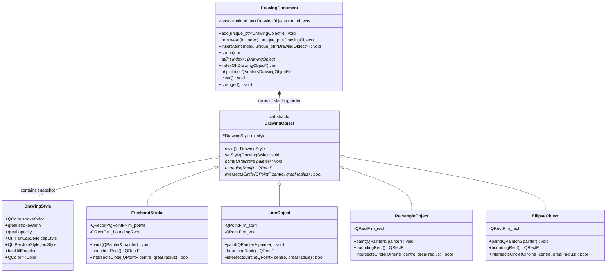

# Drawing Subsystem

## What
The Drawing Subsystem defines the document model and all persistent renderable objects on the canvas.

## Why
- **DrawingStyle vs. ToolOption separation:** `DrawingStyle` is an immutable, lightweight Plain Old Data (POD) struct stored inside each committed `DrawingObject`. In contrast, `ToolOption` represents live, mutable, interactive UI state with labels, bounds, and signals. Conflating the two would bloat every stroke with UI-layer metadata, violate single-responsibility, and make history serialization or copying complex. A frozen snapshot guarantees that subsequent tool property tweaks do not retroactively alter previously drawn artwork.
- **Catmull-Rom splines for strokes:** Connecting raw sampled input points with straight `lineTo` segments creates sharp, jagged corners at high pointer speeds. Converting sampled points through Catmull-Rom interpolation into cubic Bezier curve segments (`QPainterPath::cubicTo`) produces continuous, visually smooth strokes that pass precisely through all recorded touch/pointer positions without requiring excessive input oversampling.
- **Hierarchical hit testing:** The circular eraser must determine which objects are touched. Instead of running expensive geometry intersection tests against every object on canvas, each object provides an O(1) axis-aligned bounding box (`boundingRect()`) test. Detailed geometric distance calculations are only performed when the eraser radius overlaps the bounding box.

## How
- `DrawingDocument` maintains an ordered `std::vector<std::unique_ptr<DrawingObject>>` representing the stacking order of artwork on the canvas.
- When an object is added, removed, or inserted, `DrawingDocument` emits `changed()`, triggering a canvas repaint.
- Subclasses of `DrawingObject` (`FreehandStroke`, `LineObject`, `RectangleObject`, `EllipseObject`) override `paint()` to apply `DrawingStyle` before rendering to the provided `QPainter`.
- Hit testing is polymorphic via `intersectsCircle(centre, radius)`.

## Class Hierarchy

## Files

| File | Role |
|---|---|
| `DrawingStyle.h` | Immutable rendering snapshot POD containing colors, stroke width, opacity, and caps. |
| `DrawingObject.h` | Abstract base class declaring polymorphic rendering and hit-testing interfaces. |
| `DrawingDocument.h` | Document container owning all committed drawing objects in stacking order. |
| `DrawingDocument.cpp` | Implementation of object stacking, insertion, removal, and change notification. |
| `FreehandStroke.h` / `.cpp` | Smooth freehand stroke with Catmull-Rom spline curves and segment distance tests. |
| `LineObject.h` / `.cpp` | Two-point straight line with segment distance hit-testing. |
| `RectangleObject.h` / `.cpp` | Normalized rectangle with outline/fill rendering and boundary/interior hit-testing. |
| `EllipseObject.h` / `.cpp` | Ellipse inscribed in a bounding box with perimeter sampling and interior hit-testing. |

## Boundaries
- This subsystem does **NOT** listen to mouse or touch gestures; gesture interpretation is strictly the responsibility of the `tools` subsystem.
- This subsystem does **NOT** handle undo/redo stacks; mutations are commanded exclusively through the `history` command objects.
- This subsystem does **NOT** handle canvas painting orchestration or UI display; that belongs to `DrawingCanvas` and QML.
