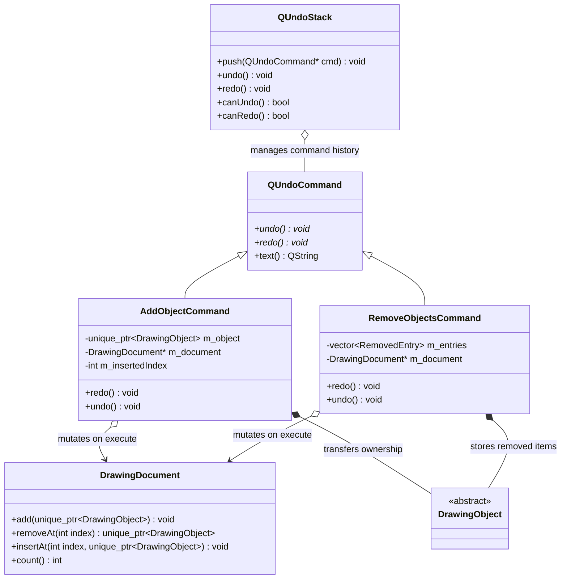

# History Subsystem

## What
The History Subsystem provides undo and redo capabilities using the Command design pattern backed by `QUndoStack`.

## Why
- **Ownership transfer via `std::unique_ptr` vs. deep copies:** Drawing objects (especially long `FreehandStroke` paths containing hundreds or thousands of sampled points) represent non-trivial memory allocations. Copying objects on every undo/redo command creation or execution wastes CPU cycles and memory. By moving `std::unique_ptr<DrawingObject>` between commands and `DrawingDocument`, undo and redo operations are O(1) pointer transfers with zero memory allocations or duplications.
- **Descending order on redo / Ascending order on undo in `RemoveObjectsCommand`:** When erasing multiple objects at arbitrary indices (e.g., indices 2, 5, 8):
  - On **redo** (removal), removing an item from a contiguous array shifts all subsequent elements to the left by one. If indices were removed in ascending order (removing index 2 first), index 5 would shift to 4 and index 8 would shift to 7, corrupting subsequent removals. Removing in **descending index order** (8 first, then 5, then 2) guarantees that higher-index deletions never perturb the positions of lower-index targets.
  - On **undo** (restoration), reinserting entries in **ascending index order** guarantees that lower-index objects are placed first, and higher-index objects push them or land cleanly at their recorded positions, completely preserving the original stacking order.

## How
- Every completed user action emits an undoable command onto `QUndoStack`.
- `AddObjectCommand` holds the newly drawn object until `redo()` appends it to `DrawingDocument`. On `undo()`, it extracts the object back out via `document->removeAt(m_insertedIndex)`.
- `RemoveObjectsCommand` stores the set of deleted objects paired with their original document stacking indices, maintaining strict descending/ascending processing invariants.

## Command Architecture

## Files

| File | Role |
|---|---|
| `AddObjectCommand.h` / `.cpp` | Encapsulates single-object addition with zero-copy pointer transfers on undo/redo. |
| `RemoveObjectsCommand.h` / `.cpp` | Encapsulates multi-object erasure preserving exact z-order and index stability. |

## Boundaries
- This subsystem does **NOT** decide when gestures start or end; commands are constructed only when a gesture completes in the `tools` subsystem.
- This subsystem does **NOT** trigger repaints directly; `DrawingDocument` emits `changed()` when items are inserted or removed.
