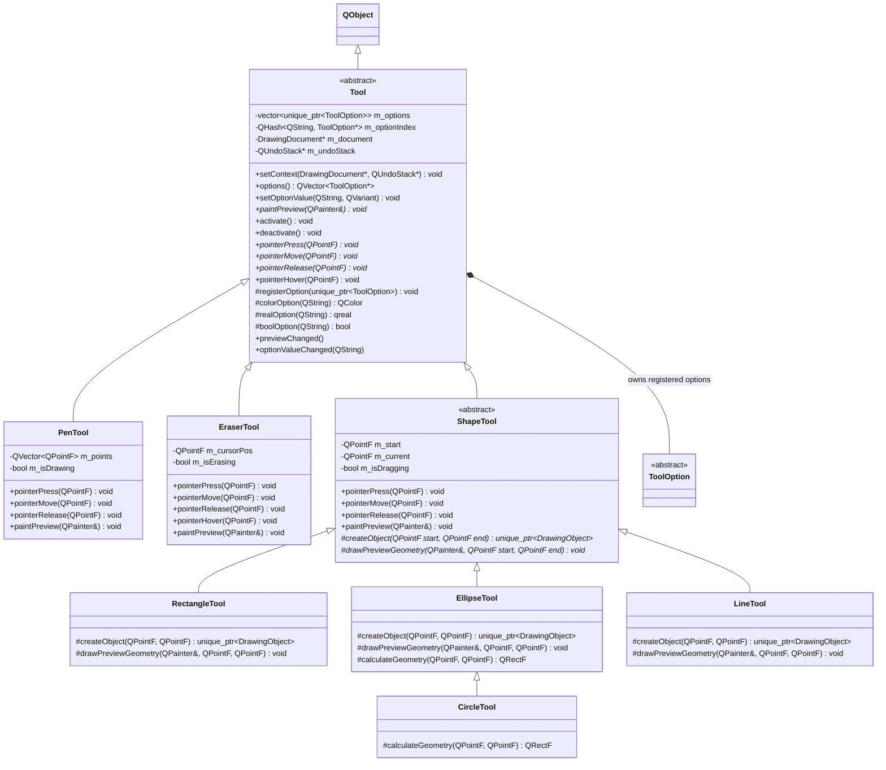

# Tools Subsystem

## What
The Tools Subsystem interprets raw pointer gestures on the canvas, renders real-time previews, and commits finished artwork or modifications to the history stack.

## Why
- **Registration over fixed struct:** In monolithic architectures, tools share a bloated, static options struct. This forces tools like `PenTool` to carry unused fill properties and requires hardcoded UI visibility matrices. With registration, each tool registers only the options it actually supports during construction.
- **Preview isolation via `paintPreview`:** In-progress gestures (such as pen strokes being actively drawn or dragging a rectangle) are not committed to `DrawingDocument`. Committing unfinished shapes would pollute the undo stack with transient frame-by-frame edits. Instead, tools render a lightweight preview directly to the canvas via `paintPreview()`, isolated from the document's committed geometry.

## How
- Every tool inherits from `Tool`, which manages its independent option registry and provides pointers to `DrawingDocument` and `QUndoStack`.
- When the user presses, drags, or releases the pointer, the canvas forwards signals to `DrawingController`, which delegates to the active `Tool` (`pointerPress`, `pointerMove`, `pointerRelease`, `pointerHover`).
- In-progress motion emits `previewChanged()`, prompting the canvas to repaint only the preview layer.
- On gesture completion (`pointerRelease`), the tool reads its own registered options to create a frozen `DrawingStyle`, instantiates a concrete `DrawingObject`, and wraps it in an undoable command (`AddObjectCommand` or `RemoveObjectsCommand`).

### How to Add a New Tool (3 Steps)
1. **Subclass `Tool` or `ShapeTool`:** Create a new class (e.g. `StarTool`).
2. **Register options in the constructor:** Call `registerOption(std::make_unique<...>(...))` for each configurable property (color, width, fill, etc.).
3. **Implement pointer gestures or `createObject()`:** Return the committed `DrawingObject` on completion. Zero modifications are required in QML or `DrawingController`.

## Class Hierarchy

## Files

| File | Role |
|---|---|
| `Tool.h` / `.cpp` | Abstract base class with option registry, context dispatch, and preview hooks. |
| `PenTool.h` / `.cpp` | Freehand drawing tool collecting sample points and committing `FreehandStroke`. |
| `ShapeTool.h` / `.cpp` | Reusable lifecycle base for two-point gesture shapes (press -> drag preview -> commit). |
| `RectangleTool.h` / `.cpp` | Concrete shape tool creating normalized `RectangleObject` instances. |
| `EllipseTool.h` / `.cpp` | Concrete shape tool creating normalized `EllipseObject` instances. |
| `CircleTool.h` / `.cpp` | Concrete shape tool creating circular `EllipseObject` instances via 1:1 constrained drag gesture. |
| `LineTool.h` / `.cpp` | Concrete shape tool creating two-point `LineObject` instances. |
| `EraserTool.h` / `.cpp` | Object eraser with hover cursor tracking and deduplicated multi-object removal. |

## Boundaries
- Tools do **NOT** own `DrawingDocument` or `QUndoStack`; they receive them non-owning from `DrawingController`.
- Tools do **NOT** handle canvas windowing or OS event pump details; they receive clean normalized `QPointF` canvas coordinates.
