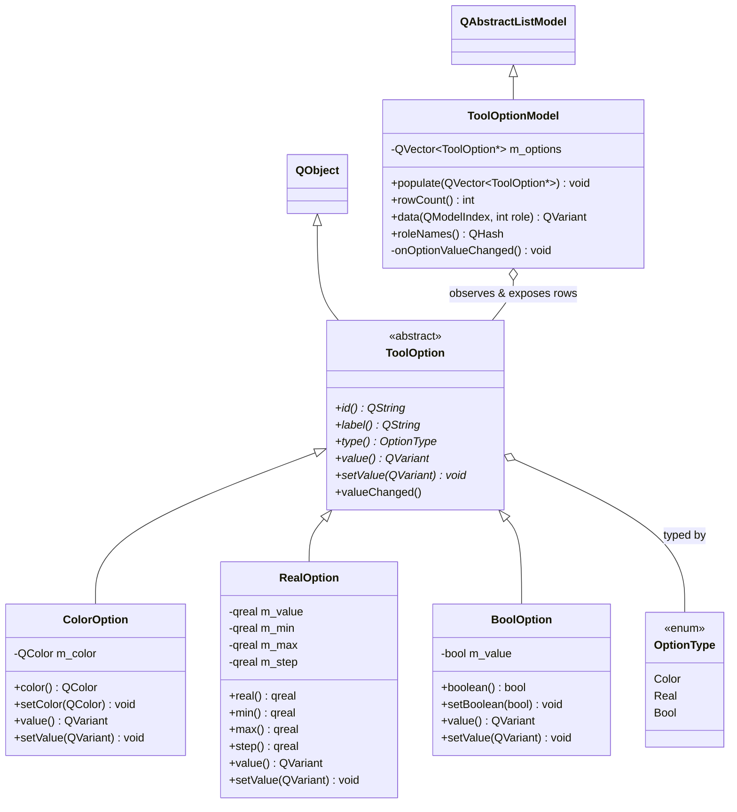

# Tool Options Subsystem

## What
The Tool Options Subsystem manages dynamically registered, strongly-typed tool configurations and surfaces them reactively to QML.

## Why
- **QAbstractListModel vs. QVariantList:** Exposing options as a raw `QVariantList` requires re-evaluating and rebuilding the entire QML view tree whenever any single property changes. A custom `QAbstractListModel` (`ToolOptionModel`) provides structured, type-safe roles (`id`, `label`, `type`, `value`, `min`, `max`, `step`) and fine-grained change notifications.
- **Granular per-row `dataChanged`:** While dragging a stroke width slider, emitting a full model reset or re-rendering all UI elements causes stutter and resets focus/interaction state. `ToolOptionModel` connects directly to each `ToolOption::valueChanged()` signal and emits `dataChanged(row, row, {ValueRole})` solely for the specific modified option. The rest of the panel remains untouched and smooth at 60+ FPS.
- **Dynamic capability registration:** Instead of hardcoding all possible properties into a monolithic tool class or fixed UI panel, each tool registers only the options it actually supports (`PenTool` registers stroke color/width/opacity; `RectangleTool` also registers fill). When a tool is selected, QML dynamically synthesizes its configuration controls using declarative loaders.

## How
- Tools instantiate and register concrete options (`ColorOption`, `RealOption`, `BoolOption`) during construction.
- When `DrawingController::selectTool()` is called, `ToolOptionModel::populate()` receives the active tool's options, unhooks old signals, hooks new `valueChanged()` signals, and emits `beginResetModel()`/`endResetModel()`.
- QML's `PropertiesPanel` binds a `Repeater` to `controller.activeToolOptions` and loads appropriate controls dynamically via the `type` role.
- UI edits invoke `controller.setOption(id, value)`, updating the model and notifying listeners without mutating existing canvas objects.

## Class Architecture

## Files

| File | Role |
|---|---|
| `ToolOption.h` | Base class defining option metadata, discriminator enum, and `valueChanged()` signal. |
| `ColorOption.h` / `.cpp` | Option storing `QColor` with color-specific type conversion and getters. |
| `RealOption.h` / `.cpp` | Option storing bounded floating-point values with min, max, and step metadata. |
| `BoolOption.h` / `.cpp` | Option storing boolean toggle state. |
| `ToolOptionModel.h` / `.cpp` | `QAbstractListModel` providing role mappings and granular row updates to QML. |

## Boundaries
- This subsystem does **NOT** dictate how tools render artwork or previews.
- This subsystem does **NOT** alter previously drawn objects; it only provides live configuration templates that tools read to stamp out frozen `DrawingStyle` instances.
